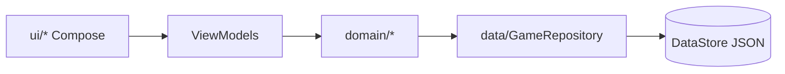

# App-Plan: Idle RPG

Stand: 2026-10-29 · Entwurf auf Basis des Ist-Zustands im Repo (aktueller Build: 0.1.0-rc10, versionCode 11) (Annahmen sind markiert). Rechtliches = Orientierung, keine Rechtsberatung.

## 1. Vision & Ziele
- **App-Name:** Idle RPG (applicationId `com.rp.IDLEGAMERP`)
- **Kurzbeschreibung:** Idle-Rollenspiel, in dem dein Held automatisch durch Ländereien zieht und Monster besiegt.
- **Langbeschreibung:** Dein Charakter kämpft in Ich-Perspektive selbstständig gegen Monster in fünf Zonen (Wiese bis Höhle). Kills bringen XP, die du frei auf Stärke, Geschick, Vitalität und Glück verteilst, und Gold für Ausrüstung im Shop. Der Fortschritt läuft auch offline weiter (begrenzt). Keine Werbung, keine Anmeldung, alle Daten bleiben lokal.
- **Ziele:** Play-Store-Freigabe (aktuell nach Ablehnung neu einzureichen), stabile Idle-Schleife, hochauflösende Vektorgrafik (siehe CLAUDE.md).

## 2. Zielgruppe & Personas
- Altersgruppe 13+ (Annahme, siehe Abschnitt 9). Gelegenheitsspieler:innen, die kurze Sitzungen und Fortschritt „nebenbei“ mögen.

## 3. Funktionale Anforderungen (MoSCoW)
| Prio | Anforderung | Stand |
|---|---|---|
| Must | Kampfschleife, Zonen, Bosse, Beute, Offline-Fortschritt | umgesetzt |
| Must | Charakter (Stats/XP), Ausrüstung (Inventar 40), Shop | umgesetzt |
| Must | Optionen: Sprache (System/DE/EN), Ton, Export/Import JSON, Reset, Datenschutz | umgesetzt |
| Must | Update-Hinweis (Play In-App Updates) | umgesetzt |
| Must | Splash-Screen mit Logo | umgesetzt (AndroidX SplashScreen, Launcher-Icon auf `#232C24`) |
| Must | Versionsnummer + Build in Optionen sichtbar | umgesetzt (Karte „Über Idle RPG“, aus `PackageInfo`) |
| Should | Crash-Reporting (opt-in) | fehlt |
| Could | Google Play Games Anmeldung | offen |
| Could | Hintergrundmusik pro Zone | bewusst nicht umgesetzt |
| Must (Entscheidung) | Spenden-Button mit Stripe-Link **bleibt drin** | Entscheidung des Entwicklers 2026-10-29; siehe Risiken |

## 4. Nicht-funktionale Anforderungen
- **Sicherheit:** keine Berechtigungen im Manifest (kein INTERNET), `allowBackup=false`, Import-Validierung (`SaveTransfer`), Release signiert, R8 aktiv.
- **Performance/Energie:** Lifecycle-gebundene Flows, Kampfschleife/Ton im Hintergrund aus, Offline-Berechnung einmalig beim Start, keine Wakelocks/Alarme/Jobs. Prüfkriterium: kein Hintergrund-CPU-Verbrauch bei pausierter App (Battery Historian / `adb shell dumpsys batterystats`).
- **Dark Mode:** App ist fest dunkel (`DarkColors`), kein Hell-Theme (Annahme: akzeptabel).
- **Offline:** vollständig offline-fähig; nur Update-Prüfung braucht Play-Dienste und scheitert still.
- **Datenschutz/DSGVO:** keine personenbezogenen Daten, nur lokal.

## 5. Architektur & Tech-Stack
Kotlin 2.0.21, Jetpack Compose (Material3), AGP 8.7.3, minSdk 26 / targetSdk 36, DataStore + kotlinx.serialization. Pakete `data`, `domain/{character,equipment,shop,world,combat}`, `ui/<feld>`, `audio`, `update`.

## 6. KI-Agenten & Lernschleife
- Agenten: `charakter`, `ausruestung`, `shop`, `optionen`, `spielwelt` (`.claude/agents/`), Lernspeicher `.claude/learnings/` (shared + je Agent), Regeln in dessen `README.md`.
- Das sind Entwicklungs-Agenten, **keine** Laufzeit-Funktion der App; es fließen keine Nutzerdaten ein → kein Consent und kein Datenschutz-Abschnitt nötig.
- Lücke ggü. Pflichtanforderung 14: Änderungen am Lernspeicher laufen aktuell direkt im Haupt-Thread, nicht per Pull Request; Review-Agent und messbare Erfolgsquote fehlen (siehe Offene Punkte).

## 7. Daten & Schnittstellen
`GameState` (Charakter, Ausrüstung, Gold, `world`, `shop`) als JSON; nur abwärtskompatibel erweitern. Export/Import als JSON-Datei in Optionen. Einzige externe Schnittstelle: Play Core `app-update`.

## 8. Qualitätssicherung & Security-Review
- Unit-Tests vorhanden (Domain, SaveTransfer, Shop, Welt).
- **Offen:** `testDebugUnitTest lintDebug assembleDebug` auf dem Emulator verifizieren (TODO.md).
- **Fehlt:** Review durch 2 unabhängige KI-Modelle verschiedener Anbieter (Code + UI-Flows) inkl. Dokumentation; Crash-Reporting.
- Review-Protokoll (vor jedem Release auszufüllen):
  | Release | Modell A | Modell B | Abweichungen | Freigabe |
  |---|---|---|---|---|
  | 0.1.0-rc10 | – | – | – | offen |

## 9. Rechtliches & Altersfreigabe
- Inhalte: Fantasy-Gewalt gegen Monster, keine Lootbox-Käufe mit Echtgeld, keine Werbung, kein Chat, keine Standortdaten, keine In-App-Käufe.
- Store: Zielgruppe 13+, IARC-Fragebogen entsprechend; USK-Bezug in DE prüfen (Annahme: niedrige Einstufung). Nicht „Kinder“ wählen (Families-Richtlinie).
- Datenschutzerklärung: https://ilitrius.github.io/rpg-game-app/ (`docs/index.html`), in Optionen verlinkt + Kurzfassung offline.
- **Entwurf Textbaustein Crash-Reporting (nur falls eingeführt):** „Mit deiner Einwilligung (Art. 6 Abs. 1 lit. a DSGVO) übermittelt die App bei Abstürzen anonymisierte Fehlerberichte (Stacktrace, Gerätemodell, Android-/App-Version) an <Anbieter, EU>. Speicherdauer: <90 Tage>. Widerruf jederzeit unter Optionen → Datenschutz.“

## 10. Risiken & Annahmen
- **Hoch: Spenden-Button.** `DonateLink` (Stripe Payment Link) und `DonateCard` sind noch im Code ([GameSettings.kt](app/src/main/java/com/idlerpg/game/ui/options/GameSettings.kt), [OptionsScreen.kt](app/src/main/java/com/idlerpg/game/ui/options/OptionsScreen.kt)), obwohl `docs/play-console-checkliste.md` ihn noch als entfernt führt (veraltet). Er wurde in Commit `f0862cc` (rc8) bewusst wieder eingebaut und in den Datenschutztexten offengelegt. Externe Zahlungslinks in der App können gegen die Play-Payments-Richtlinie verstoßen und waren ein Verdachtsgrund der Ablehnung (Grund von Google nie genannt). rc10 enthält ihn. **Entscheidung des Entwicklers (2026-10-29): Der Spendenbutton bleibt drin.** Das Restrisiko bei Play bleibt bewusst bestehen; bei erneuter Ablehnung wegen Zahlungen zuerst hier ansetzen. Checkliste ist entsprechend zu korrigieren (siehe Offene Punkte).
- Alles seit dem Sound-/Update-Stand wurde ohne baubares SDK umgesetzt (TODO.md) – Regressionsrisiko.
- Annahmen: Zielgruppe 13+, reiner Dunkel-Look ok, kein Backend.

## 11. Roadmap & Meilensteine
1. ~~Versionsanzeige, Splash-Screen~~ (erledigt 2026-10-29, Emulator-Check steht aus); Spenden-Button bleibt (Entscheidung); `docs/play-console-checkliste.md` angleichen.
2. Build/Test/Lint + Emulator-Check, Zwei-Modelle-Review dokumentieren.
3. Closed Test (12 Tester, 14 Tage), Produktionszugang.
4. Danach: Crash-Reporting + Consent-Dialog (Should), Spenden-Platzhalter ohne Funktion, ggf. Play Games.

## 12. Offene Punkte
- **Google Play Games Anmeldung mit Kontoauswahl prüfen** (Machbarkeit, Nutzen, Datenschutz; würde INTERNET/Datenerhebung ändern → Datenschutz-/Datensicherheitsformular anpassen).
- Spenden-Button bleibt mit Stripe-Link (Entscheidung 2026-10-29). Abweichung von Pflichtanforderung 6 (Platzhalter ohne Funktion) bewusst akzeptiert. `docs/play-console-checkliste.md` nennt ihn noch fälschlich als entfernt – korrigieren.
- Splash-Screen und Versionsanzeige auf Emulator/Gerät prüfen (Build + Unit-Tests grün, kein Gerät verfügbar); Bundle rc10 (versionCode 11) ist gebaut und signiert, aber nicht auf Gerät geprüft.
- Hell-Theme/Dark-Mode-Umschaltung nötig?
- Lernspeicher per PR + Review-Agent einführen? (Empfehlung: finale Freigabe beim Entwickler.)
- Crash-Reporting-Anbieter (Sentry EU vs. Crashlytics) – würde INTERNET-Berechtigung und Consent erfordern.
- Export/Import: umgesetzt (JSON) – keine Begründung nötig.
- Offline-Zeitanzeige ggf. falsch auf Gerät (TODO.md).

## 13. Änderungsprotokoll
- 2026-10-29: Plan erstmals angelegt aus Repo-Ist-Stand; Abgleich mit Pflichtanforderungen (siehe unten).
- 2026-10-29: Splash-Screen und Versionsanzeige umgesetzt; Entscheidung „Spendenbutton bleibt drin“ dokumentiert (Abschnitte 3, 10, 11, 12, Anhang).
- 2026-10-29: Version auf rc10 / versionCode 11 angehoben, Release-Bundle signiert (`release/com.rp.IDLEGAMERP-0.1.0-rc10.aab` + Mapping); `docs/play-console-checkliste.md` korrigiert (Spenden-Button bleibt); Plan auf rc10 aktualisiert.

## Anhang: Abgleich mit Pflichtanforderungen (2026-10-29)
| # | Anforderung | Ergebnis |
|---|---|---|
| 1 | Identität | ✅ Abschnitt 1 |
| 2 | Splash-Screen | ✅ `Theme.IdleRPG.Starting` + `installSplashScreen()` (visuell ungeprüft) |
| 3 | Update-Prüfung | ✅ `update/InAppUpdater` |
| 4 | Mehrsprachigkeit | ✅ `values`/`values-en`, Auswahl in Optionen (Android-Resources statt JSON-Dateien, gleichwertig) |
| 5 | Export/Import | ✅ JSON |
| 6 | Spenden-Platzhalter ohne Funktion | ⚠️ bewusste Abweichung: Button mit Stripe-Link bleibt (Entscheidung 2026-10-29) |
| 7 | Datenschutzerklärung | ✅ GitHub Pages, in Optionen verlinkt |
| 8 | Energieeffizienz | ✅ umgesetzt; Messkriterium oben ergänzt, Messung steht aus |
| 9 | Doppelte KI-Prüfung | ❌ nicht durchgeführt/dokumentiert |
| 10 | Altersfreigabe | ⚠️ Entwurf (13+), IARC/USK noch zu bestätigen |
| 11 | Offline | ✅ |
| 12 | Crash-Reporting (Should) | ❌ nicht vorhanden |
| 13 | Versionsanzeige | ✅ Optionen → „Über Idle RPG“: „Version 0.1.0-rc10 (Build 11)“, automatisch aus Build |
| 14 | Agenten-Lernschleife | ⚠️ vorhanden, aber ohne PR-Freigabe/Review-Agent/Metriken |
| 15 | Consent | ➖ aktuell nicht nötig (keine optionale Datenverarbeitung); Pflicht, sobald 12 kommt |
